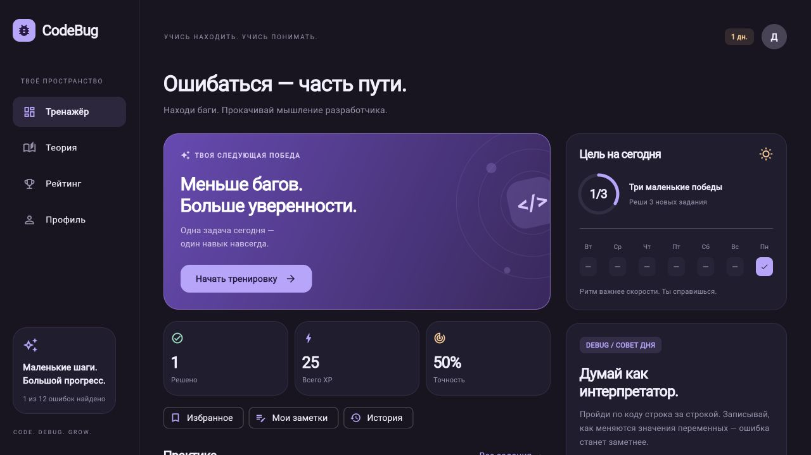
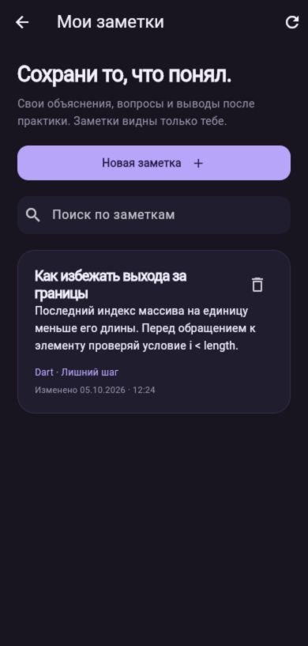
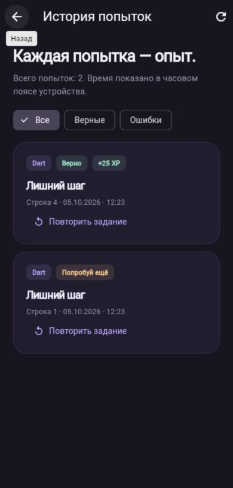

# CodeBug 3.0 — учебный тренажёр по критериям ПМ07

Мобильный учебный тренажёр поиска ошибок в коде с фиолетовым интерфейсом. Теперь это клиент-серверное приложение: Flutter/Dart + Python/FastAPI + SQLite.

## Открыть на этом Mac

Дважды нажми **«Запустить CodeBug.command»** в Finder. Скрипт запускает сервер и открывает приложение в браузере по адресу **http://127.0.0.1:8000**. Оставь окно Терминала открытым; остановка — Ctrl+C. При первом запуске нужны Python 3.11+, интернет для зависимостей, а при отсутствии `build/web` — Flutter. Пройди регистрацию: имя, email и пароль от 8 символов. Реального подтверждающего письма не отправляется.

Для нативной версии сначала запусти этот сервер, затем открой `/Applications/CodeBug.app`. Интернет не нужен после установки зависимостей, кроме ресурсов, которые web-движок может загрузить при первом открытии. При перезапуске клиента нужно войти заново: токен хранится только в памяти. Прогресс остаётся в серверной базе.

## Что работает

- Заставка с логотипом и переходом к авторизации.
- Регистрация, вход, выход с отзывом сессии; истечение сессии закрывает личные экраны.
- 12 заданий на Dart, Python, JavaScript и Java; фильтры и поиск.
- Задания загружаются через API без правильной строки и разбора.
- Проверка ответа, XP за первое решение, статистика и история попыток — на сервере.
- Повторная отправка одного запроса не дублирует попытку; одновременные решения не дублируют XP.
- Прогресс одного аккаунта доступен на разных клиентах. В профиле есть «Обновить прогресс» для получения изменений с другого устройства.
- Шесть уроков, отметки о прочтении и подсказках, редактирование имени, сброс прогресса.
- Реальный рейтинг зарегистрированных пользователей, без вымышленных участников.
- Избранные задания, доступные из каталога, главной страницы и профиля.
- Личные заметки: создание, чтение, редактирование и удаление; поиск и привязка к заданию.
- История попыток: выбранная строка, результат, дата, XP, фильтр и повтор задания.
- Понятные сообщения об ошибках подключения и сохранения, блокировка кнопки во время проверки.
- Светлая/тёмная тема, крупный код и адаптивная вёрстка. Настройки внешнего вида сохраняются на устройстве.

Старый локальный прогресс не переносится в новый аккаунт автоматически. Все аккаунты начинают с нуля; это исключает выдачу серверного XP за непроверенные локальные данные. Дневная серия рассчитывается по UTC.

## Разработка

```sh
flutter pub get
# Запусти API по инструкции backend/README.md
flutter run -d chrome --web-port 8765 --dart-define=API_BASE_URL=http://127.0.0.1:8000
flutter run -d macos
# Android Emulator: API_BASE_URL по умолчанию http://10.0.2.2:8000
flutter run -d <android-device-id>
# Телефон с доступом к опубликованному API:
flutter run --dart-define=API_BASE_URL=https://your-server.example
```

Web по умолчанию обращается к своему origin, нативный Mac — к `http://127.0.0.1:8000`. Для production-сборки с отдельным сервером передай `API_BASE_URL` в `flutter build`. Backend автоматически раздаёт содержимое `build/web`, если оно существует к моменту запуска.

```sh
flutter analyze
flutter test
flutter build web --release
flutter build macos --release
```

Android/iOS исходники есть, но APK/IPA требуют настроенного SDK/Xcode и подписи и отдельно не проверены.

## Структура

- `backend/app.py` — REST API, авторизация, транзакции, проверка ответов.
- `backend/seed.json` — исходный серверный каталог с ответами.
- `backend/data/codebug.sqlite3` — создаваемая при запуске база (не распространять).
- `backend/tests/` — интеграционные тесты API с временными базами.
- `lib/data/api.dart` — HTTP-клиент, таймаут и обработка ошибок.
- `lib/data/exercises.dart` — модель задания и учебные статьи; ответов здесь нет.
- `lib/models/progress.dart` — состояние, сессия и обращение к API через ChangeNotifier.
- `lib/ui/auth.dart` — регистрация и вход.
- `lib/ui/` — тренажёр, каталог, теория, профиль и рейтинг.
- `test/` — тесты Flutter и фикстуры, которые не входят в сборку приложения.

Полное описание API, таблиц, переменных окружения и ограничений — в [backend/README.md](backend/README.md). Для защиты курсовой удобно открыть `/docs` и показать запросы вместе с приложением.

Это учебный MVP: поиск заранее подготовленных ошибок, без исполнения произвольного кода; публичный хостинг, восстановление пароля и админ-панель пока не добавлены. Актуальная презентация «CodeBug-фронтенд-бэкенд» описывает этот стек: FastAPI и SQLite.


## Проверено в текущей версии

`flutter analyze` без замечаний, 23 теста Flutter и 10 интеграционных тестов API проходят. В браузере проверены создание аккаунта, правильный ответ с начислением 25 XP и сохранение этих XP после перезагрузки и повторного входа. Проверена ошибка сохранения: несохранённые имя и отметки остаются в интерфейсе до повтора запроса.

Mac-сборка установлена в `/Applications/CodeBug.app`, запуск проверен. Подпись локальная ad-hoc. Синхронизация Documents добавляет FinderInfo к пакету и мешает завершающей подписи Xcode: готовый пакет скопирован без расширенных атрибутов во временную папку, подписан с sandbox/network-client entitlements и проверен `codesign --verify --deep --strict`. Для публикации вне этого компьютера требуется отдельная подпись и нотариализация.


## Задание 3: анкета и текстовый файл

На экране входа доступна **«Анкета без входа»**, в профиле — **«Анкета · сохранить в файл»**. Четыре поля (имя, возраст, email, телефон) проходят валидацию. Кнопка сохранения недоступна до корректного заполнения. Нативное приложение добавляет записи в локальный `anketa.txt` в UTF-8 и показывает полный путь. Web-версия скачивает текстовый файл. После сохранения можно очистить форму. При ошибке записи данные остаются для повтора.

Подробности реализации и ответы на все 6 контрольных вопросов: [Задание 3](docs/Задание-3-анкета.md).


## Соответствие критериям ПМ07 от 5 октября 2026 года

Тема: мобильный учебный тренажёр поиска ошибок в программном коде. Цель — помочь начинающим разработчикам освоить чтение и отладку небольших программ. Целевая аудитория — студенты IT-направлений и начинающие программисты. Задачи: организовать практику по языкам и сложности, объяснять ошибки, учитывать результат на сервере и сохранять личные выводы ученика.

### Первый семестр

| Критерий | Реализация и место демонстрации |
|---|---|
| Тема, цель, задачи, аудитория | Описаны выше; основной сценарий — найти ошибочную строку и изучить разбор |
| Splash Screen | Логотип, название, фиолетовая тема; автоматический переход к входу |
| Регистрация | Имя, email, пароль; проверки полей; дубликат email обрабатывается сервером |
| Авторизация и связь с регистрацией | Учётные записи в SQLite, повторный вход, сообщения о неверных данных |
| Главная страница | Тренировка, статистика, каталог, быстрые переходы в личные разделы |
| Навигация | Нижнее меню на телефоне, боковое меню на широком экране, возврат из вложенных экранов |
| Профиль | Имя, email, уровень, прогресс, достижения и библиотека |
| Основной раздел | 12 задач, выбор строки, подсказка, серверная проверка, объяснение, повтор без повторной выдачи XP |
| Выход | Отзыв токена на сервере, очистка данных клиента и стека личных экранов |
| Введение, теоретическая глава, литература | Отдельная письменная часть курсовой; эта доработка приложения её не заменяет |
| Демонстрация | Сценарий ниже; окончательную оценку выставляет преподаватель |

### Второй семестр

| Критерий | Реализация и проверка |
|---|---|
| Анализ недостатков и план развития | В версии 2.1 отсутствовали заставка, избранное, доступная история и CRUD личных учебных материалов; в 3.0 добавлены эти функции и тесты |
| Полный основной сценарий | Поиск задания → попытка → разбор → заметка → повтор; данные связаны через идентификатор задания |
| Добавление, чтение, изменение, удаление | Полный CRUD заметок через FastAPI и SQLite. Проверены сохранность после перезапуска и разделение аккаунтов |
| Дополнительные функции | Поиск, фильтры языка/сложности/решённости, темы, избранное, история, достижения. Уведомления приведены в критериях как пример; фоновые push-уведомления не реализованы |
| Развитие профиля | Изменение имени, обновление прогресса, переходы в избранное, заметки и историю |
| UI/UX | Единые фиолетовые компоненты, светлая и тёмная темы, состояния загрузки/ошибки/пустого списка, подтверждение удаления и выхода из несохранённой заметки |
| Тестирование | Результаты и проверяемые сценарии ниже |
| Практическая глава и оформление курсовой | README описывает архитектуру, запуск и демонстрацию. Полный академический отчёт, введение, обзор аналогов, литература и оформление по методичке остаются отдельной работой |

### Архитектура и данные

Flutter/Dart отвечает за экраны, формы, навигацию и запросы. `ProgressStore` хранит состояние текущего аккаунта; `Notebook` обращается к API заметок и истории. Python/FastAPI проверяет авторизацию, права на данные и ответы на задания. SQLite хранит пользователей, хеши паролей и токенов, задания, попытки, решения, отметки уроков, избранное и заметки.

Схема 2 добавляет таблицы `favorites` и `notes` без удаления существующих аккаунтов и прогресса. Заметки принадлежат пользователю; все операции проверяют владельца. Редактирование и удаление проверяют номер версии записи: устаревшая версия не может перезаписать более свежую. Повтор создания с тем же ID и содержимым возвращает существующую заметку. Лимит — 200 заметок на аккаунт, 80 символов в заголовке и 4000 в тексте.

История загружается страницами по 30 попыток. Она показывает фактические результаты сервера и местное время устройства. Дневная серия по-прежнему рассчитывается по UTC. Сброс прогресса удаляет историю и результаты, но сохраняет заметки и избранное. Автоматическое сохранение черновиков и восстановление входа после закрытия приложения не реализованы; для повторного доступа нужно войти.

### Результаты проверки

Проверено 05.10.2026: `flutter analyze` без замечаний; 23 теста Flutter и 10 тестов API проходят. В тестовом окружении API есть предупреждение об устаревающем адаптере httpx в Starlette; результаты тестов успешны.

- Регистрация, повторный email, неверный пароль, выход и просроченная сессия.
- Правильные/неправильные ответы, одновременные запросы и отсутствие повторного начисления XP.
- CRUD заметок, обязательные поля, длинный текст на кириллице, защита чужих записей и конфликты изменений.
- Повтор создания заметки, перезапуск сервера, обновление прежней базы без потери результатов.
- Добавление/удаление избранного, сохранность при сбросе прогресса, ошибка сети без ложного успеха.
- История, порядок событий, страницы, фильтры и отсутствие выдачи решений через историю.
- Заставка, полный цикл заметки в интерфейсе, сохранение ввода при ошибке, подтверждение выхода из черновика.
- Истечение сессии на вложенном экране и защита от запоздалого ответа предыдущего аккаунта.
- Основные экраны на ширине 320 и 1440 пикселей в обеих темах; тренажёр на мобильном размере; анкета и запись UTF-8.

Найдены и исправлены: отсутствие доступной истории и полного CRUD, сохранение вложенных личных экранов после завершения сессии, несогласованная версия в разделе «О приложении», отсутствие сброса фильтров, риск переполнения панелей подсказки/результата на невысоком экране.

### Сценарий защиты

1. Запустить приложение, показать заставку. Создать аккаунт, выйти и войти снова.
2. Найти задание по языку или названию, добавить его в избранное и открыть оттуда.
3. Выбрать неверную строку, затем верную; показать разбор и начисление XP.
4. Открыть историю: видны обе попытки. Повторить решённое задание, показать отсутствие повторных XP.
5. Создать заметку к заданию, найти её по тексту, изменить, выйти и войти — запись сохранена. Удалить тестовую заметку с подтверждением.
6. Изменить имя в профиле; показать прогресс, рейтинг, темы, настройки и светлую/тёмную тему.
7. Выйти: личные экраны больше недоступны. Показать локальную анкету как отдельное учебное задание.

### Дальнейшее развитие

После этой версии: испытания на физических Android/iOS-устройствах, подготовка академической части, публикация API с HTTPS и резервным копированием, затем восстановление пароля и управление каталогом преподавателем. Администраторская роль и админ-панель в критериях не требуются и в этой версии не добавлены.


### Снимки работающей версии

Заметка создана через браузер и сохранена в SQLite; история показывает две реальные попытки демонстрационного аккаунта. Сборка web проверена на ширине 390 пикселей, Mac 3.0 установлен и запускается. Сборки Android/iOS на устройстве в этой проверке не выполнялись.






